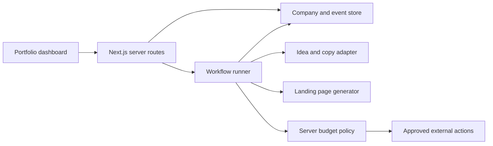

# AutoFoundry MVP

## Product

An autonomous company factory and accelerator: one parent studio creates small businesses, assigns agent roles, tracks outcomes, and allocates a limited budget across the portfolio.

## Scope for two builders

Ship one complete company lifecycle before expanding toward ten ventures. A single Next.js application owns the dashboard and server routes. Start with one shared database and explicit workflow steps. Add separate workers only when a workflow needs to outlive an HTTP request.

The original concept's Kubernetes, microservices, vector database, legal formation, ad spending, and account provisioning are outside the initial MVP. Provider capabilities and hackathon requirements must be verified before integration; the original brief is a planning reference.

## Architecture

Today, the dashboard calls pure demo transitions in browser memory and `/api/health` is the only API route. The diagram describes the next implementation step.

## Work split

Choose owners together at kickoff; these are independent tracks rather than fixed assignments.

| Track | Tasks | Acceptance |
| --- | --- | --- |
| Dashboard & demo | Portfolio cards, detail view, progress, activity, funding/stop controls, error states | Complete the demo from the UI without manually editing data |
| Agents & backend | Database, company routes, idea adapter, workflow events, landing-page output, budget checks | One company can finish a real workflow and retain its state after restart |
| Together | Shared types, integration contract, credentials, policy, walkthrough | Both machines can run the same branch and reproduce the demo |

## Build sequence

1. **Foundation:** runnable starter, public repo, collaborator access, CI. Initial commit supplies this.
2. **Persistence and API:** store company, budget allocation, and events; expose list, create, fund, and stop operations. Use transactions for budget changes, authenticate writes, and reject duplicate workflow runs.
3. **One real workflow:** generate a structured idea and copy, render a landing page, and record each step as pending/running/completed/failed. Retrying must not create duplicate assets or charge twice.
4. **Portfolio loop:** display real workflow activity, add clearly labeled sample analytics until a real signal exists, enforce server-side reserves/caps, and require human approval for stop actions or spending.
5. **Demo polish:** empty/loading/error states, a reproducible demo seed, mobile layout, and a short pitch. Add more companies after one works end to end.

## Initial server contract to agree on

| Route | Purpose |
| --- | --- |
| `GET /api/companies` | List portfolio with workflow status and budget |
| `POST /api/companies` | Validate a theme, allocate a starting grant, queue the workflow |
| `GET /api/companies/:id/events` | Fetch ordered agent/workflow activity |
| `POST /api/companies/:id/fund` | Approve a simulated or test-mode tranche within policy |
| `POST /api/companies/:id/stop` | Stop future work, return unspent allocation, retain history |

These routes are planned, not implemented. Keep money in integer cents. Keep API credentials on the server and derive studio ownership from the authenticated session. A stopped company's historic metrics and spend remain visible. Live resource cleanup requires an explicit adapter; a UI status change alone does not perform it.

## Demo script

Open the portfolio → enter a theme → spawn a company → inspect its activity → show its generated asset → fund a promising company → stop another and show returned budget. Explain which steps use live providers and which are simulated.

## Done means

- A fresh clone runs from the README.
- The spawn-to-asset path works for one company with useful error reporting.
- State survives refresh and both teammates see the shared portfolio.
- Funding cannot exceed reserves or policy; stopped companies cannot keep executing.
- CI is green and the demo accurately identifies mocked behavior.
