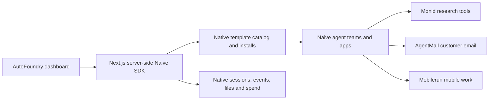

# AutoFoundry MVP

## Product and implementation constraint

An autonomous company factory and accelerator built **SDK-first and low code**. Naïve provisions and operates the companies; AutoFoundry provides the portfolio interface. The [reviewed integration plan](naive-integration-plan.md) is the current implementation reference.

Use one Next.js application with thin authenticated server-side calls to `@usenaive-sdk/managed-agents`. Prefer native template installs, teams, sessions, files, event history, and budgets. The first milestone needs no separate custom database, financial ledger, worker queue, or agent orchestrator.

The original concept's Kubernetes, microservices, vector database, legal formation, and ad spending are outside this MVP. The original brief is unverified planning material.

## Architecture

This diagram is the planned integration. Today only the browser-memory demo and `/api/health` exist; no provider is connected.

## Work split

| Track | Tasks | Acceptance |
| --- | --- | --- |
| Claude Code: SDK service | Server-only SDK client, native catalog/install read and preview calls, mocked transport tests | Calls match the published SDK types; no custom orchestration or live provisioning in tests |
| Codex: integration and dashboard | Review SDK usage/authentication, connect template questions/preview/portfolio to the UI | Native companies can be read back after refresh and simulated data is clearly labeled |
| Together with the builders | Select a real playbook, configure partner connections, walk through the result | One company performs useful work with a verifiable artifact and cost |

Use separate branches/worktrees for concurrent implementation. Coordinate dependency and shared type changes through one owner.

## Build sequence

1. **Read and preview:** install the SDK; show its catalog, setup questions, preview, and existing installs.
2. **Spawn natively:** apply a published blueprint/template through `apps.installs.apply()`, show its report, and recover the result by project after interruption.
3. **Observe:** display native agent roles, session state, ordered activity, app/artifact links, and real micro-USD spend.
4. **Connect the useful loop:** configure Monid research, an AgentMail customer inbox, and a Mobilerun mobile task through Naïve's supported extension mechanisms. Complete one business workflow before scaling the portfolio.
5. **Operate:** use native budget and complete shutdown controls first. Expose individual SDK controls only with accurate scope: cancelling a session does not shut down an entire company.
6. **Reuse:** save an approved company as a private template and apply it to another project when the first workflow works.

## Thin server surface

Start with authenticated handlers for the template catalog, install preview, installed-company list, and company context. Add native template apply and session events as the next slice. Handlers validate inputs, protect the credential/organization boundary, and call the SDK; they do not own a second copy of the business runtime or ledger.

SDK types, pagination, idempotency, partial reports, and permission limits are documented in the reviewed integration plan. Do not invent a `companies.create` method or use custom declarations as though the server provisions them automatically.

## Demo target and acceptance

Choose a company template → answer its setup questions → preview → spawn through Naïve → inspect the actual team, work, asset, and cost → demonstrate a native operating control.

- A fresh clone runs from the README, including demo mode without keys.
- A real company is provisioned through the Naïve SDK and its native install can be read after refresh.
- Both authorized builders can see the same provider-backed portfolio.
- The demo shows a verified work product and distinguishes sample metrics from real results.
- Credentials stay server-side, configured native limits govern execution, and CI is green.
