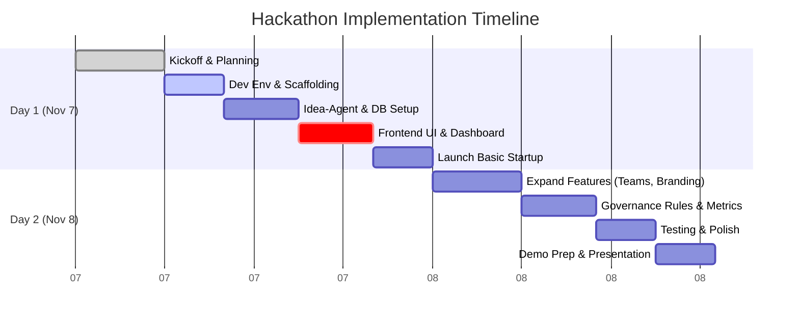

# Naïve Autonomous Company Hackathon – Project Concept

**Executive Summary:** We propose building an AI-driven *startup studio* platform (“Naïve VC”) that programmatically spawns a portfolio of ~10 startups from one parent company, with an automated “funder/kill-switch” branch to allocate resources or terminate underperformers.  In effect, the parent company acts like a modern venture studio or accelerator (à la YC), but with agents and code performing much of the work.  Our system uses modular microservices and agent orchestration to automate idea generation, company formation (legal and technical setup), branding, and basic operations.  A governance layer encodes funding rules and human approvals.  We will demo an interactive dashboard showing each AI-run startup’s status, metrics, and controls to inject more funding or shut it down.  The hackathon MVP (48–72h) will focus on core flows: spawning companies from AI-proposed ideas, deploying simple web assets and automations, and visualizing key metrics.  This report covers the value proposition, system design, automation pipeline, governance rules, UX, implementation roadmap (with Gantt chart), risk/legal issues, and a comparative table of accelerator/studio precedents.  (We assume a small engineering team, use of Python/JS, cloud free tiers, and ~\$1k credit budget.)

## Product Concept & Value Proposition

The Naïve Hackathon challenges builders to create “agent-run companies that run themselves”.  Our project, **AutoStudio**, is a hybrid startup studio/accelerator where AI agents handle most routine startup tasks.  Like Y Combinator (YC) or Techstars, it generates new ventures in parallel, but agents and templates do the heavy lifting.  The core value is automating “grunt work” of company creation and early ops, freeing founders to focus on strategy.  For example, **Naïve** (the hackathon sponsor) offers infrastructure to “automate most of the work in setting up and running a business” via API calls.  We build on this idea: given a prompt or theme (e.g. “food delivery”) our system will use LLMs to *brainstorm startup ideas*, assemble a founding “team” of AI agents (marketing, dev, ops agents), and scaffold a minimal product.  This includes incorporating the company (e.g. forming a U.S. LLC) and provisioning cloud resources.  Agents then carry out tasks (design logo, write code, launch ads, etc) using connected tools.  The *demonstration* is a portfolio of live “micro-startups” (e.g. one-page sites, simple apps or social profiles) and a control panel showing their metrics.  

This automation unlocks scale: instead of one product, we can trial ~10 ventures concurrently.  By clustering startups under a common parent, we reuse shared resources (branding style, cloud infra, code libraries).  The funder/kill branch then monitors these ventures, automatically funding ones hitting targets (users, revenue, engagement) and killing others.  This mimics a YC partner deciding which companies deserve the next round. In sum, **AutoStudio** offers the value proposition of a venture studio augmented by AI: rapid idea-to-company cycles, low manual workload, and data-driven portfolio management.

## System Architecture

AutoStudio’s backend is a collection of microservices and agent runtimes orchestrated in the cloud.  We use Docker containers (or serverless functions) for each service, managed by Kubernetes (or AWS ECS/EKS) to scale with load.  Key components include: 

- **Web Frontend & API:** A React/Next.js dashboard and REST/GraphQL API for user interaction. This frontend displays spawned companies, their metrics, and provides controls (fund, kill, configure).  
- **Agent Orchestrator:** A core service that coordinates AI agents.  When tasked with “create new startup”, it breaks down goals (generate idea, build landing page, etc.) and dispatches agents in parallel to handle sub-tasks.  Each agent runs in its own sandbox (e.g. a lightweight Node/JS environment or serverless function), following a piece of the company’s “playbook”.  (For cost efficiency, we can use serverless containers as in Naïve’s approach, so we only pay when agents are active.)
- **AI/LLM Integrations:** Agents leverage LLMs (OpenAI, Anthropic Claude, open models) for tasks like idea brainstorming, code writing, and copywriting. A **Prompt Manager** module feeds context and template prompts to LLMs, and a **Memory Store** (vector DB) retains company-specific data (brand guidelines, past outputs).
- **Data Stores:** A relational database (e.g. PostgreSQL) tracks company records, user data, and agent logs. A vector database (e.g. Chroma, Weaviate) holds embeddings for context retrieval (to avoid LLM hallucination by chunking memory). We also use object storage (S3 or GCS) for assets (images, files) and any generated media.
- **Microservice APIs:** Dedicated services handle tasks like company incorporation (via a service like Clerky/Stripe Atlas API or Naïve’s incorporation API), domain & email provisioning (via Cloudflare, SendGrid/Twilio), and cloud infra (Terraform/CloudFormation for servers/storage).
- **CI/CD & DevOps:** Code pipelines (GitHub Actions/GitLab CI) build and deploy all services. Infrastructure is declared via code (Terraform/Kubernetes manifests) for reproducibility. A single Git repo contains “governance code” (see below) that agents cannot modify.
- **Governance Service:** Enforces budgets, user roles, and safety. It reads policies (max spend, kill criteria, approval workflows) from a committed config. Agents report actions here and are halted if they exceed budget or lack approval.

This modular design (frontend, orchestrator, services, DBs) ensures components scale and can be debugged independently.  It mirrors modern cloud-native architectures, using containerized microservices, message queues (e.g. RabbitMQ or AWS SQS) for agent tasks, and best-practice CI/CD.

## Automation: Generating Companies

### Idea Generation
We automate startup ideation with an LLM-based **Idea Agent**. Given a broad domain or business theme (or random seed), the agent queries a model (e.g. GPT-4) with prompts to generate viable startup concepts, value props, and names.  To ensure diversity, the agent may use fixed templates (e.g. “In 2-3 sentences, describe an AI-driven [domain] startup and its target customer. Then propose a catchy name.”).  It can also filter ideas by feasibility (e.g. check via online data if similar products exist).  Optionally, we allow hackathon participants’ companies to seed ideas (since the hackathon encourages reusing peers’ creations).  

### Team Composition
Once an idea is chosen, we assemble a virtual founding team of AI *roles*.  For example: a CEO agent (strategizes), a Developer agent (writes code), a Marketer agent (handles outreach), and a Social Media agent (handles content).  The roles are defined by templates in code.  Each agent is given distinct credentials (email, Slack/webhook, domain alias) so it can act in the real world.  For example, a “Voice AI” agent might have an account in a messaging app, while a “DevOps” agent has access to AWS/GitHub.

### Code Scaffolding & Deployment
We automate product scaffolding by using templates and code-generation tools.  For a web app, a **Dev Agent** might run a framework CLI (e.g. `create-react-app` or `django-admin startproject`) via code, or even call an OpenAI Code model to generate boilerplate code.  We can store a set of repo templates (e.g. a landing page repo, an e-commerce stub) and let the agent fork or branch them.  The pipeline automatically runs tests (if any) and deploys the site (using Heroku, Vercel, or a simple container on AWS/GCP).  We automate DNS and hosting: for example, an API call to a cloud DNS service sets a subdomain, and the app is containerized and pushed.  Deployment success/failure is logged and shown on the dashboard.

### Branding & Assets
Branding is semi-automated.  A **Design Agent** prompts a generative image model (e.g. DALL·E or Stable Diffusion) to create a logo based on the startup name and theme.  A domain names agent can suggest matching domains (via Namecheap API or NameMesh).  Copywriting (slogans, pitch paragraphs) is generated by LLMs. These are collected into a brand kit (logo PNG, tagline, color palette) that the company uses.  

### Legal & Admin Templates
To simulate real-world formation, we integrate legal templates.  For example, the system can auto-generate an LLC formation document (or just simulate it) and PDF “Company Articles” using a service like Clerky or by filling out an open PDF template.  In practice, Naïve’s API can handle actual incorporation (state, NAICS code, etc) with KYC checks.  For the hackathon, we can simplify by populating a legal template with the company name and founder details, and log that the entity is formed.  Similarly, tax IDs or Stripe merchant accounts can be automatically created via API calls, or mocked for the demo. 

### Orchestrated Workflows
All these steps form an agent workflow.  For example, to launch a startup: 
1. Idea Agent → selects concept.  
2. Assign roles → set up accounts/identities for each agent.  
3. Dev Agent → scaffold code, deploy web app.  
4. Ops Agent → provision email, CRM, Stripe account.  
5. Marketing Agent → design logo, write landing page copy.  
6. Launch Agent → publish site, create social accounts.  
At each stage the workflow can run in parallel where possible (e.g. branding while code is being written) and wait on human review only for major steps.  By encoding the workflow in code (e.g. as a JSON/YAML plan), the platform ensures consistency.  No agent can alter the workflow script itself, so steps execute as intended.

## Governance & Funding/Kill Decision Rules

We implement a **Governance Engine** that continually evaluates each startup’s performance against preset criteria.  It encodes both automated rules and human-overrides. Key elements include:

- **Metrics Tracking:** The system collects data on each startup: web traffic (via Google Analytics API), user signups or sales (from backend logs or Stripe), social engagement (API calls to Twitter/Instagram), and spending (API logs of ad spend or agent consumption). It also tracks agent activity (how many API calls, GPT tokens used).  
- **Threshold Rules:** We define thresholds (configurable) for success or failure. For example: *“If monthly revenue >\$X or growth rate >Y%, unlock next funding tranche.”* Conversely, *“If revenue = \$0 after 2 weeks, or cost exceeds budget without leads, then terminate.”* These rules live in the committed policy file.  When a condition is met, the Governance Engine triggers actions (e.g. release more budget to an agent or mark company inactive).  
- **Human-in-the-Loop:** Major decisions (especially kills) require a manual review via the dashboard. The UI alerts the hackathon user when a startup crosses a kill threshold, and they can choose to override. This follows best practices of AI oversight; as one authority notes, an “AI governance board” or review committee should sign off on high-risk decisions. In our case, the hackathon participant plays that role.  
- **Funding Allocation:** The “funder branch” is essentially a budget pool. Initially, each startup receives an equal micro-budget (e.g. cloud credits, ad spend, token budget). As metrics come in, the system can reallocate budget (e.g. give higher levers to promising companies). We simulate this by adjusting a spending cap variable per company. Agents will fail if they try actions beyond their budget, reflecting real fiscal constraints.  
- **Kill Switch:** If a startup hits a kill condition (e.g. no user signups, negative ROI, or failed launch), the platform can automatically wind it down: agents are deactivated and resources (domains, servers) are released. The company remains visible in the dashboard (marked “shutdown”) but no further actions occur.

We may also incorporate a simple predictive model: for instance, a linear regression or decision tree that learns from past companies’ early metrics to predict success, and flags at-risk ventures early.  However, given time, we prioritize rule-based logic.  The goal is rigorous yet transparent governance: policies are code-reviewed and immutable to agents.

## Demo UX & Dashboard

Our hackathon demo is a single-page dashboard (Web app) that visualizes the multi-company ecosystem. Key elements:

- **Company Portfolio View:** A table or grid showing each spawned startup (named row). For each, display status (Active/Killed), key stats (e.g. mock users, revenue, last update).  
- **Metrics Graphs:** Selecting a company opens its performance charts (traffic over time, leads, spend). We use simple charting (Chart.js or VegaLite) for visuals.  
- **Control Panel:** Next to each company are buttons: *“Fund”* (inject additional budget), *“Kill”* (manually terminate), *“View Agents”* (to inspect agent logs or tasks), and *“View Logs”*. Funding and kill buttons trigger API calls to the governance service. We display warnings on kill actions (Y/N prompt).  
- **Agent Activity Feed:** A timeline feed shows major actions (e.g. “Dev Agent deployed site at 12:05”, “Marketing Agent posted tweet”). This is optional but demonstrates the automation.  
- **Global Controls:** At top, a master “Spawn New Company” button to trigger the idea pipeline (for live demo). We may also have a countdown timer (to mimic hackathon real-time), and an overall budget bar showing remaining funds.  

User interaction flow: Click **Spawn** → enter a prompt/press to use random idea → see new company appear with initial assets → watch agents execute tasks (could animate with “running” status) → see metrics update over a short period (we can simulate growth data). Judges can then click “Fund” on a high-flyer or “Kill” on a flop, demonstrating the theme.  

No external data is needed; for the demo we either simulate analytics (e.g. increment visits every few seconds) or use stub APIs. We ensure the UX is responsive and clearly ties back to our architecture (hover tips show which agent did what).

## Implementation Roadmap & Tech Stack

**Assumptions:** We assume a team of ~3-4 engineers, 48–72h continuous dev, using familiar web and AI tools. The budget is limited to free tiers (e.g. \$1k AWS credits). We’ll write prototypes in Python (agents, backend) and JavaScript (frontend). 

**MVP Features (48h):** 
1. **Core spawn flow:** One button triggers the agent pipeline to create a new “company”. Use a fixed or random idea initially. Integrate GPT-4/Claude for idea and copy.  
2. **Basic deploy:** Generate a static site (e.g. via S3/Netlify) or simple web page for each startup. Auto-generate a logo (placeholder image).  
3. **Database & tracking:** Record each startup in a DB, simulate a few metrics (e.g. random “visits”).  
4. **Dashboard UI:** List companies and statuses. Implement *Fund*/*Kill* controls (which can just log actions).  
5. **Governance rules:** Hardcode simple rule (e.g. if *“visits”* <10 by time T, disable the company).  
6. **CI/CD:** GitHub Actions to deploy frontend/backend upon changes (for demonstration reliability).  
7. **Use of Naïve SDK (optional):** If allowed offline, use it to show one automated step (like incorporation via API). If not, simulate it in code (like an HTTP GET to a “Naïve” endpoint).  
   
**Day-by-Day Plan (see timeline below):** Day 1 morning – set up repo, frameworks, basic DB and UI. Day 1 afternoon – implement spawn logic, agent stubs (calls to LLM or fixed scripts). Evening – hook up simple deploy (e.g. create AWS S3 bucket or Netlify site). Day 2 – refine flows: add more agent tasks (email, Stripe link), implement governance stub (kill rule), polish UI (graphs, logs). Final hours – add branding (logo gen API call), test all flows, prepare demo pitch.

**Tech Stack & Tools:** We favor free/open-source and managed services. For example:  
- **Compute/Hosting:** AWS free-tier (Lambda, ECS fargate, S3, DynamoDB) or Heroku free dynos for backend. Vercel/Netlify for frontend. Naïve provides a cloud sandbox for agents if used.  
- **AI & Agents:** OpenAI API (ChatGPT/GPT-4) or Anthropic (if free trial). LangChain (Python) for orchestration scaffolding. Mobilerun’s API for phone automation (if we include mobile tasks).  
- **Databases:** PostgreSQL (via AWS RDS free or Supabase free tier) or SQLite for MVP. A small vector DB like Pinecone/Chroma (free credits) if we store memory.  
- **APIs & Integrations:** Stripe test mode (payments), SendGrid/Twilio (emails/SMS – use free tier), Cloudflare (domains), GMail API.  
- **CI/CD:** GitHub Actions or GitLab CI (both free for small repos) to auto-deploy frontend/backend on push. Docker Hub (private free repos) for container images.  
- **Open-source Tools:** Use templating libraries (Jinja2) for legal docs, FOSS analytics (Plausible or static counters) for site metrics. Possibly use existing code generators (e.g. Cookiecutter templates).  

**Low-Budget Notes:** We rely on free service tiers (AWS Always Free, free Stripe sandbox, free LLM credits). Even AWS Lambda’s free tier offers ~1M requests/month.  By using static hosting and serverless, we keep costs near $0 during hackathon. A small AWS credit (e.g. \$100) covers typical usage. 

## Comparative Table: Startup Studios & Accelerators

| Entity                  | Model                        | Description                                                                 |
|-------------------------|------------------------------|-----------------------------------------------------------------------------|
| **Y Combinator (YC)**   | Accelerator (Seed fund)      | Premier accelerator (founded 2005). Invests ~$500K for ~7% equity per batch; provides mentorship & Demo Day. Alumni include Airbnb, Stripe.  |
| **Techstars**           | Accelerator (Seed fund)      | Global 3-month accelerator. Invests ~$220K for 5% equity; includes mentorship, networking and perks (AWS credits, etc). |
| **Idealab**             | Venture Studio/Incubator     | Founded 1996, one of the first *startup factories*. Created 100+ companies (e.g. Overture, CitySearch) by spinning multiple ideas. |
| **Atomic**              | Builder Studio               | Seattle-based studio (founded 2015) that launches internal ideas into startups (e.g. Homebound, companies built from scratch). |
| **Pioneer Square Labs** | Builder Studio               | Co-founded 2015, Seattle studio combining startup inventing and VC funding. Runs ~1-2 new ideas per cohort. |
| **Betaworks**           | Venture Studio / Investor    | NYC-based media/tech studio (founded 2007). Builds products in-house (e.g. ChatGPT competitor) and invests in early startups. |
| **Rocket Internet**     | Startup Studio (Clonehouse)  | Berlin group that replicates successful US startups (e.g. launched Groupon clones worldwide) with in-house teams. |
| **Naïve**               | AI Autonomous Platform       | Startup providing infrastructure for agent-driven companies. Automates LLC formation, email, payments, etc. (“Frontier of Autonomous Companies”). Hosts this YC hackathon. |
| **(Other)**             | Accelerators/Studios         | E.g. 500 Startups, Science Inc., eFounders (SaaS studio), etc. Usually provide funding + resources but not AI-based automation. |

Each model differs: accelerators give money and mentorship to external teams, while studios ideate and staff projects internally.  Naïve (and emerging “AI cofounder” tools like NanoCorp) represent a new breed: automating many founder tasks.  (Notably, products like Polsia claim similar autonomation, though quality/legitimacy vary.)

## Risks, Ethical & Legal Considerations

Building autonomous startups raises novel risks and legal questions. 

- **Liability & Compliance:** An AI-run company must still meet legal requirements. For instance, incorporation requires a human signature and KYC/AML checks. We assume a founder/user stands in for these steps. If automated, missteps (wrong business licenses, IP violations) could have liability. We must log all actions and ensure final approval on sensitive steps (as Naïve’s “human approval” does).  
- **Data Privacy & Security:** Agents will use real services (email, cloud). We must secure API keys and not expose PII. Ethical frameworks (e.g. from Dataiku) emphasize audit trails and token filtering.  All agent interactions with third-party models should scrub personal data.  
- **AI Fairness & Bias:** LLMs can hallucinate or spit out biased content. In governance, we include sanity checks (e.g. “verify all claims in reports”) or require human review of marketing content. As one analyst notes, AI agents must be governed by policy and accountability frameworks to prevent abuse.  
- **Economic/Job Impact:** This project is experimental, but widespread agent-run businesses could disrupt jobs.  We should disclaim in the demo that real-world use is limited and meant to augment, not replace, human startups.  
- **Ethical AI Use:** Follow general AI ethics (OpenAI usage policies, attributing generated content, etc.). If an autonomous company interacts with customers, there should be disclosure (“this is an AI-operated service”).  

## Evaluation Metrics

To judge the system (and in hackathon scoring), we propose metrics across dimensions:

- **Technical Functionality:** Number of startups successfully spawned; correctness of automation steps; system stability (no crashes).  
- **Business Success:** For each startup, track proxy KPIs (simulated revenue, user count, ROI). We might aggregate “portfolio ARR” or average growth rate. The funder branch could be scored by how well it allocated to winners (e.g. “capital efficiency”).  
- **Automation Quality:** Measure how many tasks were fully automated vs required manual intervention. For example, count manual approvals needed or tasks abandoned.  
- **Efficiency:** Time and cost to launch a startup. E.g. “time from spawn to launch” and total compute/API cost (token usage). Lower cost per company indicates better efficiency.  
- **User Experience:** For the demo, evaluate UX metrics like clarity of dashboard, ability to interact (could use user testing or heuristic check).  
- **Innovation:** Creativity of ideas generated (subjective, possibly judged by novelty of spawned startups).

These metrics combine system logs and self-reported progress (e.g. each company logs its key outcomes). They align with startup performance KPIs that investors use (growth, retention, LTV) and measure how well our automation accelerates startup building.

Each task above corresponds to deliverables: e.g. “Launch Basic Startup” involves connecting the orchestrator, generating an idea, and deploying a simple site. “Expand Features” adds things like auto-generated logo and agent roles.  The timeline is aggressive but focuses effort on an end-to-end flow by Day 2.

**Sources:** We drew on the Naïve platform design (its website and TechCrunch article), startup studio literature, and AI governance best practices. These guided our architecture and rules. The YC hackathon announcement (via Mobilerun) confirms event scope and suggests integrations (mobile automation). TechCrunch and Naïve sources specifically inform our use of APIs for company setup and budgets. 

