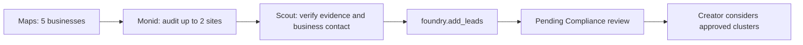

# First pipeline: Maps to Compliance

One vertical slice implements the [contract](foundry-contract.md). Scout identifies buyer/problem clusters; it does not choose a product or price.



## Run

```sh
pnpm naive:check
pnpm monid check
pnpm scout apply --foundry-app app_f27yeve1gzgmztexhf9d0wbx62
pnpm scout pipeline --query "dentists Mission District San Francisco" --request-id YOUR_UNIQUE_REQUEST_ID
pnpm scout status --session RETURNED_SESSION_ID
pnpm scout collect --session RETURNED_SESSION_ID
```

The app ID was verified in the shared org on November 7; other orgs need their own ID. The pipeline uses a fresh Maps tool ID, depth 5 and language `en`, with an inspected **2,000 micro-USD/call** price. It audits at most two distinct hosts using Monid's fixed `dataforseo /onpage/instant-pages` endpoint, **150 micro-USD/call**, with JavaScript, resource loading and rendering disabled. Maximum quoted source cost: **2,300 micro-USD ($0.0023)**, separate from the managed session's configured **300,000 micro-USD ($0.30)** cap.

Scout may fetch six pages to verify general business inquiry forms or published business emails. Booking, intake and checkout pages do not qualify. It preserves provider receipts, source IDs and observed issues in lead data, distinguishing inferred gaps from explicit requests. Foundry starts saved clusters at `pending`; this is a review handoff, not approval. Zero qualified leads is valid.

Raw observations/context go to ignored `var/scout/pipeline/`; collected session outputs go to ignored `var/scout/`. A completed request ID reuses its sources and exact session request. A `.started` marker blocks automatic paid retries after a lost collection response. Inspect provider history before restarting incomplete collection. This is a local workflow, not a second Foundry service or job queue.

## Live verification

- Scout `agt_rnbp77qjtrxz9j1ykpngxwydgn`, version 5, GLM-5.2-FP8; session `ses_a3rwmz3206x380kynsp5z7d02a` ended cleanly. Naïve reports **132,240 micro-USD** consumed.
- Maps returned five listings and reported **2,000 micro-USD**.
- Monid audits `01M6W7E2981DP45TKW67VRE3ED` and `01M6W7E6PM7P23FT3BZDGKMANG` completed with upstream HTTP 200 and **150 micro-USD reported each**.
- Foundry tool event `evt_eajvf0s1rnx4ex52f16s8cw5wp` returned `{cluster_id: cl_m6zz2yk4ltpssqdlqijt, added: 1, skipped: 0, signal_count: 1, review_status: pending}`.
- Replaying the pipeline request returned the same session ID and reused source receipts.

This verifies collection, native app-tool visibility, persistence and pending-review handoff. **The candidate is not approved:** all contact-page fetches returned 429, and Scout incorrectly accepted a NexHealth appointment URL as a business inquiry route. Its recurrence explanation also incorrectly treated two audited sites as meeting the three-business threshold. The prompt now expressly rejects booking routes and includes exact scoring examples. These tightened rules need a new live qualification check before unattended use. The existing candidate stays pending for Compliance; no approval or outreach occurred.

No deployment was enabled. `pnpm scout deploy` creates the original native Scout cron; it does not invoke this local source collector. Scheduling this exact enriched pipeline requires Felix's existing app to expose the bounded source helper through an agreed tool or scheduled trigger. Do not label the Scout-only cron as this whole pipeline.

## Other Monid starter sources

Discovered November 7, not executed except the separately tested X source. Quotes require fresh inspection before use.

| Source | Catalog endpoint | Signal | Quote |
|---|---|---|---|
| X | `twitterdata.io /tweets/search` | Business requests/pain; discard ads and consumer chatter | 250 micro-USD/call |
| Reddit | `anyapi /reddit.search` | Recurring problem discussions; verify buyer identity | From 350 micro-USD/call, route dependent |
| App Store reviews | `litescrape /app-store/reviews` | Repeated complaints; developer is the potential buyer | 150 micro-USD/call, health unknown |
| Screenshot | `anyapi /web.screenshot` | Rendered evidence beyond plain HTML | From 1,300 micro-USD/call, route dependent |

The catalog also lists image generation (`minimax /v1/image_generation`, 3,500 micro-USD/result) and company enrichment. Those may support Creator/Builder after offer approval; they are outside this first pipeline. See [Monid setup and bounded X research](monid.md).
